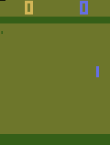
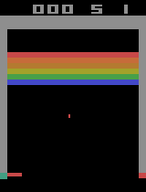
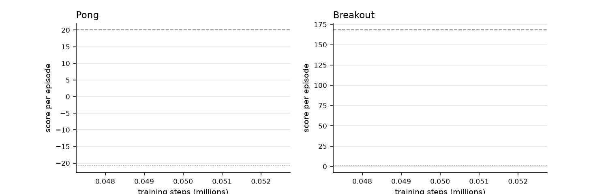

# Atari DQN

DeepMind's 2013 paper *Playing Atari with Deep Reinforcement Learning*, rebuilt from scratch in PyTorch and trained on a laptop CPU: one network learns to play Atari from screen pixels and the score alone.

  
  

**[How it works: the website](https://amalmehta.github.io/AtariRL/)** · [Setup and usage](docs/INSTRUCTIONS.md) · [System design](docs/SYSTEM-DESIGN.md) · [File structure](docs/FILE-STRUCTURE.md) · [The paper](https://arxiv.org/abs/1312.5602)
