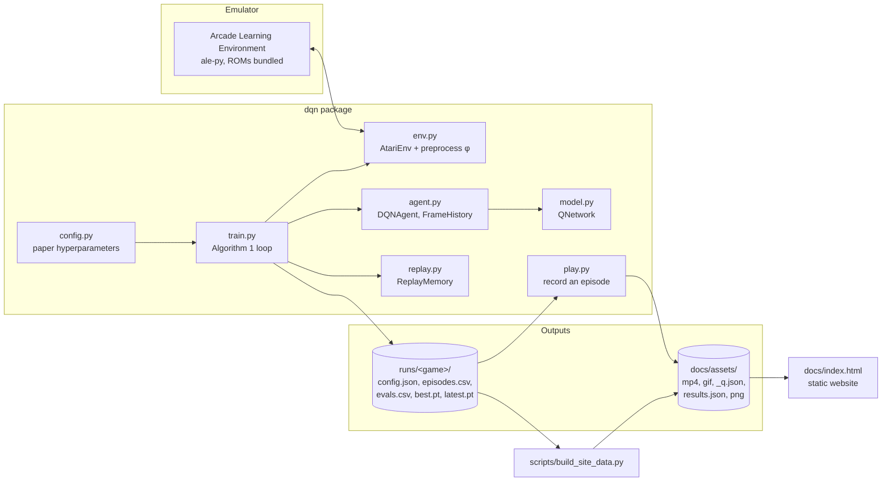

# System Design

Atari DQN rebuilds Mnih et al. 2013, *Playing Atari with Deep Reinforcement Learning*: one convolutional network learns to play Atari games from screen pixels and the score alone. This document covers how the code is put together. For what each idea means, see the [website](https://amalmehta.github.io/AtariRL/).

## Architecture

## Components

| Component | Job |
|---|---|
| `dqn/config.py` | One `Config` dataclass holding every hyperparameter, defaulting to the 2013 paper's values. Values the paper omits are marked and taken from the 2015 Nature paper. |
| `dqn/env.py` | Talks to the ALE directly (no Gymnasium). Implements the paper's preprocessing φ for one frame (grey → 110×84 → 84×84 crop), frame skipping with summed reward, and the minimal action set. Deterministic: sticky actions off. |
| `dqn/model.py` | The paper's network: two conv layers (16×8×8/4, 32×4×4/2), a 256-unit dense layer, one linear output per action. Takes uint8 frames and scales to [0, 1] inside. |
| `dqn/replay.py` | Circular replay memory that stores each 84×84 frame once and rebuilds 4-frame stacks at sample time, handling episode starts and buffer wrap-around. |
| `dqn/agent.py` | ε-greedy action choice, the linear ε schedule, the Q-learning target and squared-error update (RMSProp by default, Adam optional), and the average-max-Q metric. Optionally keeps a frozen target network for computing targets. `FrameHistory` keeps the agent's last 4 frames while playing. |
| `dqn/train.py` | Algorithm 1: act, store, sample, update; plus per-epoch evaluation (ε = 0.05), held-out-state Q tracking, CSV logs and checkpoints. CLI entry point. |
| `dqn/play.py` | Loads a checkpoint, plays one episode, writes an MP4, a short GIF starting 2 s before the first point, and every step's Q-values to JSON. |
| `scripts/build_site_data.py` | Converts run logs (including the earlier failed Pong runs, as baselines) into `results.json`, renders the preprocessing illustrations and the README chart. |
| `docs/index.html` | The website. Static HTML + vanilla JS; draws its charts as SVG from `results.json` and `*_q.json`, syncs the value chart with the gameplay video. |

## Main flows

**Training** (`python -m dqn.train`)
1. Build the env, a second env for evaluation, the agent and the replay memory.
2. Play randomly to collect 500 fixed held-out states (`heldout.npy`).
3. Every step: pick an action ε-greedily → step the emulator k frames → store `(frame, action, clipped reward, done)` → after `replay_start` steps, every `update_every` steps sample 32 transitions and take one optimizer step. If `target_update` is set, copy the weights into the target network every `target_update` steps.
4. Every `eval_every` steps (one "epoch"): play `eval_steps` steps with ε = 0.05 in the evaluation env, compute mean max Q on the held-out states, append to `evals.csv`, save `latest.pt`, and `best.pt` if the eval score is a new best.

**Recording** (`python -m dqn.play`): load weights → play one ε = 0.05 episode → video + Q-value trace.

**Publishing**: `scripts/build_site_data.py` → `docs/assets/` → GitHub Pages serves `docs/`.

## Where data lives

| Data | Location | In git? |
|---|---|---|
| Hyperparameters, logs, checkpoints for a run | `runs/<game>/` | No (`.gitignore`); checkpoints are ~2.7 MB each and reproducible |
| Replay memory | RAM only (`np.zeros`, pages committed as filled: ~7 GB at 1M) | No |
| Website data and media | `docs/assets/` | Yes |
| Atari ROMs | Bundled inside the `ale-py` wheel | No |

## Key design decisions

| Decision | Why | Trade-off |
|---|---|---|
| Use the ALE directly instead of Gymnasium wrappers | Every preprocessing step the paper describes is visible in ~60 lines; matches the paper's deterministic setup | Less interoperable with off-the-shelf RL tooling |
| PyTorch for autograd, everything else hand-written | Agent, memory, preprocessing and loop are "from scratch" without re-deriving backprop | Depends on PyTorch 2.2.2, the last release with Intel-Mac wheels |
| Store frames once in replay | 4× less RAM (7 GB vs 28 GB at 1M transitions) | Stack reconstruction needs careful boundary handling (covered by tests) |
| No target network by default, MSE loss, reward clipping | Faithful to 2013 | Less stable than the 2015 recipe |
| A fast-learning recipe for the published Pong agent: Adam 1e-4, target network every 1k steps, update every step, 100k replay, ε over 100k steps | With the paper's settings Pong stayed at random level after 750k steps (no target network) and 850k steps (with one); those settings need ~1–2.5M steps, over a day on this CPU. The fast recipe started winning at 275k steps | Pong isn't trained with the paper's hyperparameters, and the two games use different settings (the paper used one set). Both failed runs are kept in `runs/` and shown on the site |
| Breakout: update every 4 steps (paper: every step) | ~4× faster on a CPU where one update takes ~20 ms | Fewer gradient steps per transition than the paper; flag `--update-every 1` restores it |
| Breakout: ε anneals over 250k agent steps | The paper says "first million frames"; at k = 4 that's 250k steps | Other reimplementations read it as 1M steps |
| Long runs launched as a one-off launchd job (`launchctl submit`) with a no-restart guard | Runs started from a Claude Code session were killed when the session ended, twice | macOS-specific; launchd relaunches the job when it exits, so the guard makes the relaunch idle instead of retraining |
| Static site, data loaded with `fetch` | Free hosting on GitHub Pages, no build step | Must be served over HTTP (not opened as a file) for charts to load |

## Testing

`pytest tests/` (about 20 s on a quiet machine) covers:
- preprocessing shape/dtype, frame skip advancing exactly k emulator frames, the minimal Pong action set, k = 3 for Space Invaders;
- replay: frame order in stacks, padding at episode starts and at the start of the buffer, next-state alignment, never sampling the newest slot, wrap-around excluding overwritten histories;
- network layer shapes match the paper; ε schedule; TD target with terminal masking; loss decreasing on a fixed batch;
- the target network staying frozen until synced and being off by default; RMSProp by default and Adam when chosen;
- an end-to-end 600-step training run producing checkpoints and two eval rows.

The real test is the training curves on the website.

## Known limits

- CPU-only training on this machine: runs are far shorter than the paper's 10M frames per game, and only Pong and Breakout were trained. Breakout was stopped at 350k steps when RAM ran out with two runs going.
- Pong's published result (best evaluation 17.2) comes from a tuned fast recipe, not the paper's settings; the paper's settings never learned Pong within 850k steps here.
- Pong evaluations late in training cover only 2–5 games each (long rallies fill the 10k-step window), so single epochs are noisy: 17.2 at 475k, 7.7 at 500k.
- The Breakout agent rarely presses FIRE and can wait a long time before serving.
- Runs can't be resumed: the replay memory is in RAM only, so a killed process restarts from scratch.
- Deterministic emulator with ε = 0.05 evaluation: scores can be optimistic compared with sticky-action evaluation used by later work.
- One seed per game; no confidence intervals.
- `best.pt` is chosen by noisy evaluation scores, so the recorded episode is a favourable one.
- The crop window (rows 18–102 of the 110×84 image) suits most games but isn't tuned per game, as in the paper.
